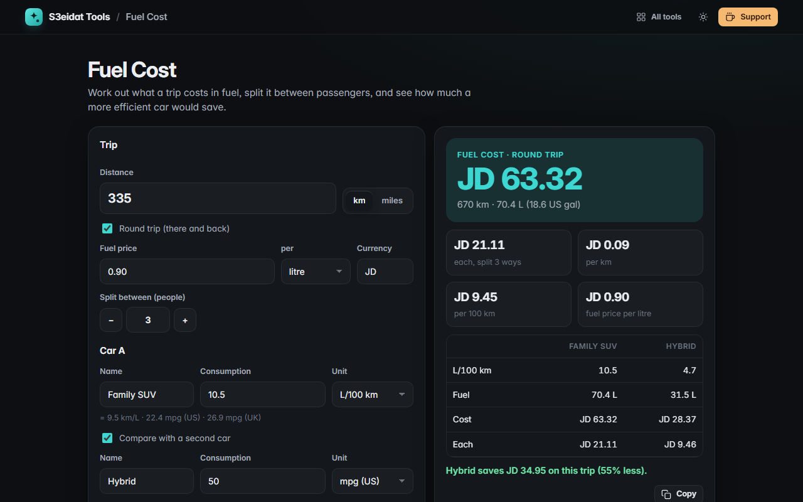

# Fuel Cost

> What will this trip cost in fuel? Free, private, and it runs entirely in your browser.

### ▶ [Open Fuel Cost](https://s3eidat.github.io/fuel-cost/)



## Features

- Distance in **km or miles**, one way or **round trip**
- Consumption in **L/100 km, km/L, mpg (US) or mpg (UK)**, with the equivalent in every other unit shown underneath; switching unit converts the number you typed
- Fuel price **per litre, US gallon or UK gallon**, in any currency
- **Total cost**, fuel needed (litres and gallons), **cost per km or mile** and per 100
- **Split** the cost between passengers
- **Compare two cars** (optionally with a different fuel price) and see which saves how much
- Copy a plain-text summary; your inputs are remembered in this browser

Conversions: 1 mile = 1.609344 km, 1 US gallon = 3.785411784 L, 1 UK gallon = 4.54609 L (so 30 mpg US ≈ 7.84 L/100 km).

## Privacy

Nothing you enter leaves your device. There is no server, no account, no analytics.
The page ships with a strict Content-Security-Policy (`connect-src 'self'`), so the browser
itself blocks any attempt to send data anywhere.

## Run it yourself

It's plain HTML, CSS and JavaScript with no build step:

```bash
git clone https://github.com/s3eidat/fuel-cost
cd fuel-cost
python -m http.server 8000
```

Then open http://localhost:8000.

## Support

If this saved you time, **[buy me a coffee ☕](https://s3eidat.github.io/coffee/)**. It keeps every tool free.

---

Part of **[S3eidat Tools](https://s3eidat.github.io/)**: 100+ free, private tools that run in your browser. MIT licensed.
